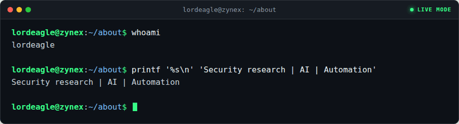

<div align="center">


<p>
  
  
  
</p>

**Ethical Hacker · Security Researcher · AI Builder · Automation Developer**

[Website](https://website.lordeagle.tech) · [GitHub](https://github.com/lordeagle-tech) · [WhatsApp](https://wa.me/254114879633) · [Telegram](https://t.me/Eagle1591) · [Instagram](https://instagram.com/eagle.254)


</div>

---

### About Me

I’m **Lord Eagle**, an ethical hacker, penetration tester, and software builder focused on practical security research, AI-assisted tooling, automation, and digital infrastructure.

Through **[Zynex Tech](https://website.lordeagle.tech)**, I build tools that explore the edge of cybersecurity, artificial intelligence, messaging automation, and developer productivity.

<div align="center">



</div>

---

### What I Do

- Build tools for **authorized penetration testing and security research**.
- Develop **AI-assisted security agents**, OSINT workflows, and RAG applications.
- Create **messaging, workflow, and infrastructure automation**.
- Research web, API, network, BLE, USB, and Linux security.
- Turn technical research into practical, documented software.

---

### Current Focus

<table>
<tr>
<td><b>01</b><br>AI-assisted security tooling</td>
<td><b>02</b><br>Web and API security research</td>
<td><b>03</b><br>OSINT and intelligence automation</td>
</tr>
<tr>
<td><b>04</b><br>Secure messaging systems</td>
<td><b>05</b><br>Self-hosted infrastructure</td>
<td><b>06</b><br>Defensive security workflows</td>
</tr>
</table>

<details>
<summary>System status</summary>

```text
[ SYSTEM STATUS ]
Security Research      ACTIVE
AI Automation          ONLINE
OSINT Operations       ACTIVE
Threat Analysis        ACTIVE
Infrastructure         MONITORED
```

</details>

---

### Featured Projects

<table>
  <tr>
    <td width="50%" valign="top">
      <h3>🧠 <a href="https://github.com/lordeagle-tech/aihelper">CampusIQ</a></h3>
      <p>AI-powered campus intelligence that classifies notices, extracts deadlines, summarizes updates, and answers questions with cited evidence.</p>
      <p><code>Python</code> · <code>Streamlit</code> · <code>RAG</code> · <code>AI/ML</code></p>
      <a href="https://github.com/lordeagle-tech/aihelper">View project →</a>
    </td>
    <td width="50%" valign="top">
      <h3>💬 <a href="https://github.com/lordeagle-tech/eagle-baileys">Eagle Baileys</a></h3>
      <p>WhatsApp and messaging automation for the Zynex ecosystem.</p>
      <p><code>JavaScript</code> · <code>Node.js</code></p>
      <a href="https://github.com/lordeagle-tech/eagle-baileys">View project →</a>
    </td>
  </tr>
  <tr>
    <td width="50%" valign="top">
      <h3>🤖 <a href="https://github.com/lordeagle-tech/zynex-MD">Zynex MD</a></h3>
      <p>Extensible messaging automation built for experimentation and custom bot workflows.</p>
      <p><code>JavaScript</code> · <code>Node.js</code></p>
      <a href="https://github.com/lordeagle-tech/zynex-MD">View project →</a>
    </td>
    <td width="50%" valign="top">
      <h3>🔐 <a href="https://github.com/lordeagle-tech/ToothPaste">ToothPaste</a></h3>
      <p>Secure BLE and USB data transfer for authorized testing and media control.</p>
      <p><code>TypeScript</code> · <code>BLE</code> · <code>USB</code></p>
      <a href="https://github.com/lordeagle-tech/ToothPaste">View project →</a>
    </td>
  </tr>
  <tr>
    <td width="50%" valign="top">
      <h3>🛡️ <a href="https://github.com/lordeagle-tech/shannon">Shannon</a></h3>
      <p>AI-assisted web and API security analysis to help discover and validate vulnerabilities.</p>
      <p><code>TypeScript</code> · <code>AI</code> · <code>AppSec</code></p>
      <a href="https://github.com/lordeagle-tech/shannon">View project →</a>
    </td>
    <td width="50%" valign="top">
      <h3>🔎 <a href="https://github.com/lordeagle-tech/ZimZilla">ZimZilla</a></h3>
      <p>Offensive security and OSINT automation for authorized testing and research.</p>
      <p><code>Python</code> · <code>OSINT</code> · <code>Security</code></p>
      <a href="https://github.com/lordeagle-tech/ZimZilla">View project →</a>
    </td>
  </tr>
</table>

> Explore more work in my [repositories](https://github.com/lordeagle-tech?tab=repositories).

---

### Skills & Technologies

#### Programming


#### Cybersecurity

Web & API Security · Penetration Testing · OSINT · Network Analysis  
Vulnerability Research · Exploit Development · BLE/USB Security · CTF Tooling  
Linux Security · Payload Development · Defensive Security Research

#### AI & Automation

RAG Applications · AI Security Agents · NLP · Semantic Search  
Local LLM Tooling · WhatsApp Automation · Workflow Automation · Data Extraction

#### Infrastructure

Linux · Docker · VPS Management · DNS · Streamlit · Node.js · Git · GitHub

---

### Security Research

I build and study offensive-security tooling to understand how systems fail and how they can be better protected. My work includes web and API testing, OSINT, network analysis, wireless and USB security, vulnerability research, and AI-assisted security workflows.

> All security research and offensive tooling shown here is intended for authorized testing, education, defensive research, and controlled lab environments. Never test systems without explicit permission.

---

### Security Philosophy

> Understand the attack. Improve the defense.

I build security tools to identify weaknesses, improve resilience, and support authorized testing, education, and defensive research.

---

### Zynex Tech

**[Zynex Tech](https://website.lordeagle.tech)** is my independent technology brand for building practical tools across:

- Cybersecurity and penetration testing
- AI-assisted research and automation
- Messaging and developer tools
- Digital infrastructure and self-hosted services

---

### GitHub Activity

<div align="center">


</div>

### Recent Activity

<div align="center">


</div>

---

### Connect With Me

<p align="center">
  <a href="https://website.lordeagle.tech" title="Visit my website"></a>
  <a href="https://github.com/lordeagle-tech" title="View my GitHub"></a>
  <a href="https://wa.me/254114879633" title="Message me on WhatsApp"></a>
  <a href="https://t.me/Eagle1591" title="Message me on Telegram"></a>
  <a href="https://instagram.com/eagle.254" title="View my Instagram"></a>
</p>

---

<div align="center">

<i>“Break it. Fix it. Secure it.”</i>

<b>— Lord Eagle | Zynex Tech</b>

</div>
